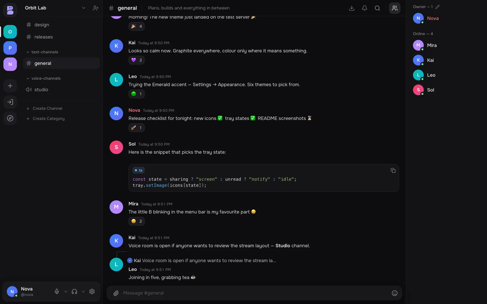
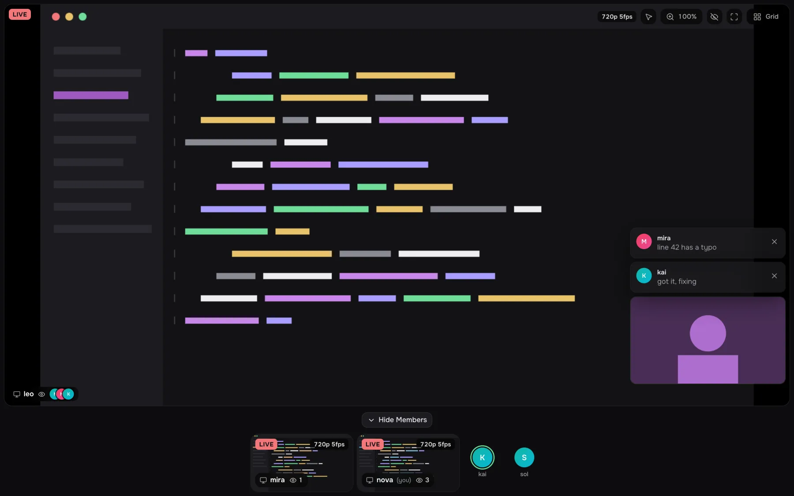
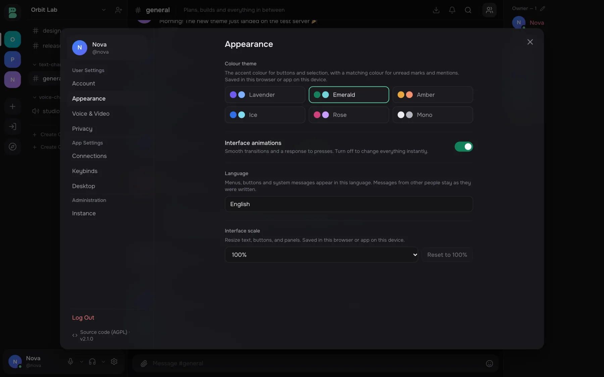
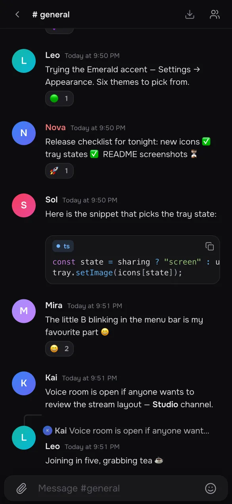

<p align="center">
  <picture>
    <source media="(prefers-color-scheme: dark)" srcset="assets/brand/b-space/png/lockup-128.png">
    <source media="(prefers-color-scheme: light)" srcset="assets/brand/b-space/png/lockup-on-light-128.png">
    
  </picture>
</p>

<p align="center">
  <strong>Свой Discord на своём сервере. Текст, голос, видео, демонстрация экрана.</strong><br>
  Самостоятельный форк <a href="https://github.com/TheZwiss/backspace">TheZwiss/backspace</a> со своим интерфейсом и своими сборками приложения.
</p>

<p align="center">
  <a href="https://github.com/funpin/B-SPACE/releases/latest"></a>
  <a href="https://github.com/funpin/B-SPACE/actions/workflows/ci.yml"></a>
  
  <a href="LICENSE"></a>
</p>

<p align="center">
  <a href="https://github.com/funpin/B-SPACE/releases/latest"><b>Скачать</b></a> ·
  <a href="#быстрый-старт"><b>Быстрый старт</b></a> ·
  <a href="#персонаж-b">Персонаж B</a> ·
  <a href="#чем-форк-отличается-от-оригинала">Отличия от оригинала</a> ·
  <a href="docs/systems">Как устроено</a> ·
  <a href="README.en.md">English</a>
</p>

<p align="center"></p>

## Что умеет

| | |
|---|---|
| **Голос и видео** | Каналы и звонки в личных сообщениях. Громкость от 0 до 200 % отдельно для каждого человека и каждой трансляции, шумоподавление RNNoise, сведения о соединении в реальном времени. |
| **Демонстрация экрана** | Разрешение, частота кадров, кодек (VP9 или аппаратный H.264) и битрейт — на выбор, до 4K при 120 кадрах в секунду в пределах, заданных администратором. Звук системы передаётся вместе с картинкой. |
| **Чат** | Каналы и категории, ответы, реакции, упоминания, стикеры, вложения, предпросмотр ссылок, подсветка кода, поиск по сообщениям с фильтрами. |
| **Личные сообщения** | Один на один и группы до 10 человек, звонки, друзья и заявки в друзья. |
| **Роли и модерация** | Права по ролям с переопределением для категорий и каналов, баны с причиной, отключение микрофона и звука участнику, заявки на вступление. |
| **Федерация** | Независимые серверы связываются между собой: друзья, личные сообщения и звонки работают между серверами, каждый остаётся у своего владельца. |
| **Где работает** | Браузер, приложение для Windows и macOS, телефон — как устанавливаемое веб-приложение. |

## Интерфейс «Камень»

Графитовые поверхности без оттенка, цвет — только там, где он что-то значит: непрочитанное, упоминание, «в эфире», говорит. Содержимое лежит на матовых панелях, всё, что всплывает поверх, — плотное стекло. Шрифт Onest, иконки Lucide.

<table>
  <tr>
    <td colspan="2"><br><sub><b>Голосовой канал</b> — трансляция в фокусе, остальные экраны и участники в ленте, чат звонка поверх картинки</sub></td>
  </tr>
  <tr>
    <td width="72%" valign="top"><br><sub><b>Оформление</b> — шесть акцентных тем: Лаванда, Изумруд, Янтарь, Лёд, Роза, Моно</sub></td>
    <td width="28%" valign="top"><br><sub><b>Телефон</b> — тот же клиент как веб-приложение</sub></td>
  </tr>
</table>

## Персонаж B

<p align="center"></p>

Знак B:SPACE — буква **B из двух реплик**: верхняя говорит, нижняя отвечает. У верхней есть глаза, поэтому знак одновременно и персонаж. Эмоции он показывает только глазами и движением, без рта и бровей. Персонаж встречает на экране входа и в пустых состояниях интерфейса, а в трее — строке меню macOS и панели задач Windows — показывает, что происходит: непрочитанное, демонстрация экрана, «Не беспокоить», нет связи.

| | Состояние | Когда | Движение |
|:---:|---|---|---|
|  | **Ожидание** | По умолчанию | Моргает раз в 3–4 с |
|  | **Оглядывается** | Загрузка, подключение, поиск | Взгляд влево, потом вправо |
|  | **Новое сообщение** | Непрочитанное, упоминание | Прыжок, глаза шире, красная точка |
|  | **Пишет** | Кто-то печатает | Взгляд вниз, точки в теле бегут по очереди |
|  | **Говорит** | Голосовой канал, говорит пользователь | Тело пульсирует, зелёное кольцо |
|  | **Демонстрация экрана** | Пользователь показывает экран | Тело становится экраном, в углу мигает красная точка |
|  | **Радуется** | Сообщение отправлено, вход выполнен | Глаза «^ ^», один прыжок |
|  | **Не беспокоить** | Статус «Не беспокоить» или «Отошёл» | Глаза закрыты |
|  | **Нет связи** | Сервер недоступен | Серый, глаза «× ×» |

В трее пять из них — ожидание, новое сообщение, демонстрация экрана, «Не беспокоить» и нет связи; там значок статичный и только меняет кадр. Если в системе включено «Уменьшить движение», персонаж не двигается. Файлы знака, правила использования и цвета — в [assets/brand/b-space](assets/brand/b-space/README.md).

## Чем форк отличается от оригинала

| | |
|---|---|
| **Имя и облик** | Свой логотип и персонаж, свой интерфейс «Камень» с акцентными темами на выбор. |
| **Сборки приложения** | Две, без лишнего: **Windows x64** (установщик) и **macOS Apple Silicon** (DMG). Linux, Windows на ARM и Intel-Mac здесь не собираются — их выпускает [оригинальный проект](https://github.com/TheZwiss/backspace/releases). |
| **Ссылки и обновления** | Приложение, панель «Скачать» и проверка обновлений ведут на этот репозиторий, а не на оригинал: версии расходятся, и исходный код должен быть тот, что реально запущен (AGPL, раздел 13). |
| **Сервер** | Свой образ Docker (`ghcr.io/funpin/backspace`) и три необязательные настройки: создание пространств только администратором, срок хранения вложений, отключение миниатюр. |
| **Голосовой канал** | Одна плитка на человека вместо двух, участники без видео — лентой под сеткой, плитки можно скрывать и переставлять. |

С версии 2.0.0 форк ведётся независимо: он вырос из оригинального 1.11.0 и больше не подтягивает оригинал целиком. Отдельные исправления оттуда переносятся по одному, когда они нужны.

## Быстрый старт

**Приложение.** Скачайте сборку со страницы [последнего релиза](https://github.com/funpin/B-SPACE/releases/latest): **Windows** — установщик, **macOS (Apple Silicon)** — DMG. При первом запуске укажите адрес своего сервера. Новую версию ставьте поверх старой: вход и настройки сохраняются.

**Сервер.** Нужен Linux-хост с Docker и домен:

```bash
git clone https://github.com/funpin/B-SPACE.git backspace && cd backspace
./install.sh
```

Установщик сам настроит `.env`, секреты, HTTPS и, если нужно, голос. Первый зарегистрированный пользователь становится администратором. Обновление — `./update.sh`, резервные копии и восстановление — `./backup.sh` и `./restore.sh`.

Режимы за своим обратным прокси или туннелем, порты и голос подробно разобраны в [документации по развёртыванию](docs/systems/deployment.md) и в [README оригинала](https://github.com/TheZwiss/backspace#installation).

<details>
<summary><b>Как устроено</b></summary>

- **Сервер** — Node.js, Fastify, SQLite через Drizzle; один контейнер, данные в `data/`.
- **Клиент** — React, Vite, Tailwind, Zustand; интерфейс «Камень»: графитовые матовые панели для содержимого и плотное стекло для всего, что всплывает поверх.
- **Голос и видео** — LiveKit; сервер только выдаёт токены, медиа идёт через SFU.
- **Приложение** — Electron: глобальные сочетания клавиш, запуск при входе в систему, значок-персонаж в трее, определение запущенной игры.
- **Федерация** — запросы между серверами подписаны HMAC, события доставляются через очередь с повторами.

Подробно по каждой подсистеме — в [docs/systems](docs/systems): [голос](docs/systems/voice.md), [федерация](docs/systems/federation.md), [права](docs/systems/permissions.md), [база данных](docs/systems/database.md), [приложение](docs/systems/desktop.md), [дизайн-система](docs/systems/design-system.md). Брендбук — в [docs/brand](docs/brand/brandbook.md).
</details>

<details>
<summary><b>Разработка</b></summary>

Node.js 22.12 или новее (в `.nvmrc` — 24) и pnpm 10:

```bash
pnpm install
cp .env.example .env    # задайте JWT_SECRET: openssl rand -hex 32
pnpm dev                # сервер на :3005, клиент на :5173
pnpm typecheck && pnpm test
```

Экраны можно смотреть без сервера и без звонка: страницы `packages/web/dev-*.html` открываются с того же dev-сервера, например `http://localhost:5173/dev-voice-grid.html`.

Как ведётся форк:

- `origin` — этот репозиторий, `upstream` — оригинал. Работа идёт в ветках `feat/…`, `fix/…`, `chore/…` от `main` и попадает в `main` через pull request.
- Оригинал целиком не подтягивается. Нужное исправление оттуда переносится отдельным pull request (`git cherry-pick` из `upstream`), с проверкой, что оно ложится на наш код.
- Версии свои, обычный semver: `2.0.0`, `2.1.0`, `2.0.1`. Поднимаются командой `node scripts/bump-version.mjs 2.1.0`. Релизы до 2.0.0 назывались по оригиналу (`1.11.0-f.1.1` — «ревизия 1.1 поверх оригинального 1.11.0»).
- Релиз — тег `v<версия>` на `main`: [workflow](.github/workflows/release.yml) собирает обе сборки и создаёт черновик релиза с таблицей загрузок.

Правила для агента — в [CLAUDE.md](CLAUDE.md), участие — в [CONTRIBUTING.md](CONTRIBUTING.md).
</details>

## Лицензия

[GNU AGPL-3.0](LICENSE): пользуйтесь, меняйте и распространяйте свободно, если ваши изменения тоже открыты. B:SPACE — форк [Backspace](https://github.com/TheZwiss/backspace) © TheZwiss и участники проекта; оригинал также предлагает [коммерческую лицензию](LICENSE-COMMERCIAL.md) — она относится к оригинальному коду и выдаётся его автором. Шрифт Onest в надписи логотипа — SIL OFL 1.1.

Правки форка © 2026 funpin
