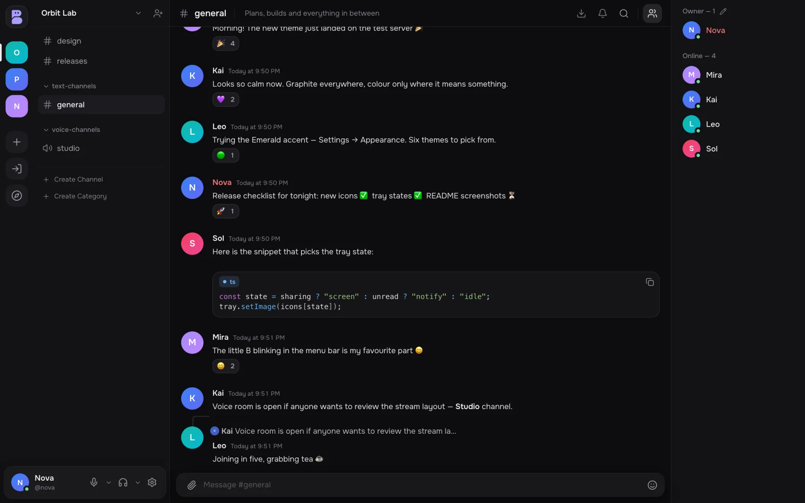
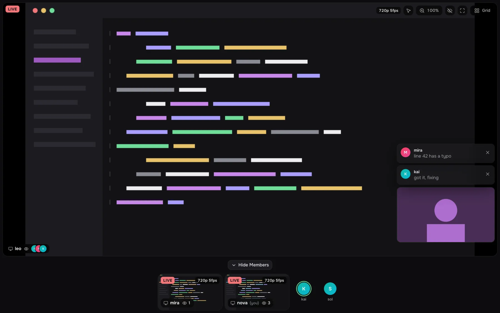
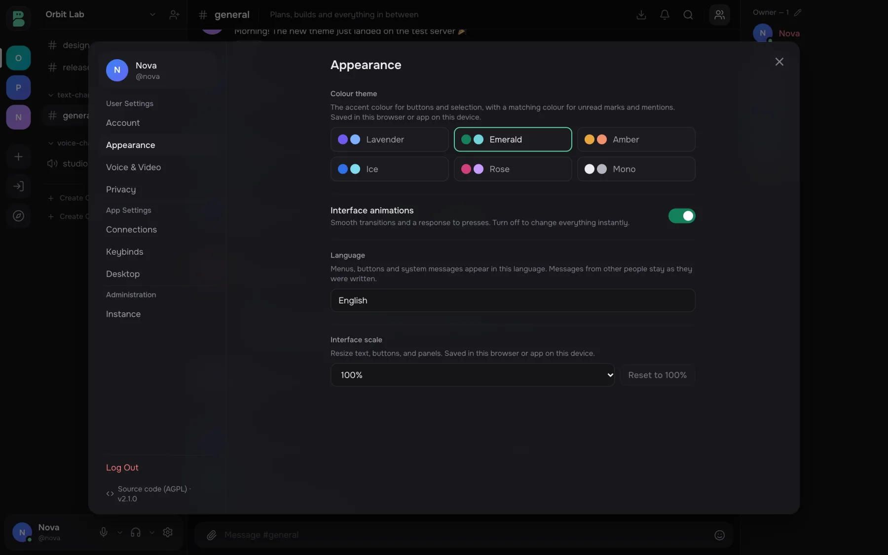
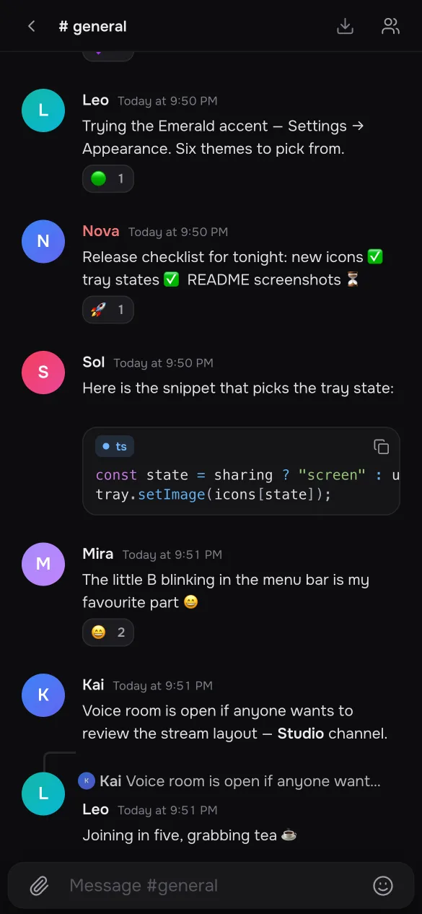

<p align="center">
  <picture>
    <source media="(prefers-color-scheme: dark)" srcset="../assets/brand/b-space/png/lockup-128.png">
    <source media="(prefers-color-scheme: light)" srcset="../assets/brand/b-space/png/lockup-on-light-128.png">
    
  </picture>
</p>

<p align="center">
  <strong>Your own Discord on your own server. Text, voice, video and screen sharing.</strong><br>
  An independent fork of <a href="https://github.com/TheZwiss/backspace">TheZwiss/backspace</a> with its own interface and its own app builds.
</p>

<p align="center">
  <a href="https://github.com/funpin/B-SPACE/releases/latest"></a>
  <a href="https://github.com/funpin/B-SPACE/actions/workflows/ci.yml"></a>
  
  <a href="../LICENSE"></a>
</p>

<p align="center">
  <a href="https://github.com/funpin/B-SPACE/releases/latest"><b>Download</b></a> ·
  <a href="#quick-start"><b>Quick start</b></a> ·
  <a href="#meet-b">Meet B</a> ·
  <a href="#how-the-fork-differs-from-the-original">Fork differences</a> ·
  <a href="#documentation">Documentation</a> ·
  <a href="../README.md">Русский</a>
</p>

<p align="center"></p>

## Features

| | |
|---|---|
| **Voice and video** | Channels and calls in direct messages. Volume from 0 to 200 % per person and per stream, RNNoise noise suppression, live connection stats. |
| **Screen sharing** | Resolution, frame rate, codec (VP9 or hardware H.264) and bitrate are yours to pick, up to 4K at 120 fps within the limits the admin sets. System audio goes along with the picture. |
| **Chat** | Channels and categories, replies, reactions, mentions, stickers, attachments, link previews, code highlighting, message search with filters. |
| **Direct messages** | One-on-one and groups of up to 10, calls, friends and friend requests. |
| **Roles and moderation** | Role permissions with category and channel overrides, bans with a reason, server mute and deafen, join requests. |
| **Federation** | Independent servers link up: friends, DMs and calls work across servers, and each server stays with its owner. |
| **Where it runs** | Browser, Windows and macOS app, phone as an installable web app. |

## The "Kamen" interface

Graphite surfaces with no tint, and colour only where it means something: unread, a mention, live, speaking. Content sits on matte panels; whatever floats above it is dense glass. Onest type, Lucide icons.

<table>
  <tr>
    <td colspan="2"><br><sub><b>Voice channel</b>: a stream in focus, the other screens and members in the strip, call chat over the picture</sub></td>
  </tr>
  <tr>
    <td width="72%" valign="top"><br><sub><b>Appearance</b>: six accent themes, Lavender, Emerald, Amber, Ice, Rose and Mono</sub></td>
    <td width="28%" valign="top"><br><sub><b>Phone</b>: the same client as a web app</sub></td>
  </tr>
</table>

## Meet B

<p align="center"></p>

The B:SPACE mark is a **B made of two speech bubbles**: the top one speaks, the bottom one answers. The top bubble has eyes, so the mark is also a character. It shows feelings with its eyes and movement only, never a mouth or brows. B greets you on the sign-in screen and in the interface's empty states, and in the tray (the macOS menu bar, the Windows taskbar) it shows what is going on: unread messages, a screen share, Do Not Disturb, no connection.

In the tray B moves too and shows the same states. With "Reduce motion" on in the system, B stays still. All nine states, the mark files, usage rules and colours are in the [logo and character notes](../assets/brand/b-space/README.md) (in Russian).

## How the fork differs from the original

| | |
|---|---|
| **Name and look** | Its own logo and character, its own "Kamen" interface with selectable accent themes. |
| **App builds** | Two, nothing extra: **Windows x64** (installer) and **macOS Apple Silicon** (DMG). Linux, Windows on ARM and Intel Macs are not built here; the [original project](https://github.com/TheZwiss/backspace/releases) releases them. |
| **Links and updates** | The app, the Download panel and the update check point to this repository, not the original: the versions diverge, and the source has to be the code that actually runs (AGPL, section 13). |
| **Server** | Its own Docker image (`ghcr.io/funpin/backspace`) and three optional settings: only admins create spaces, attachment retention, thumbnails off. |
| **Voice channel** | One tile per person instead of two, members without video in a strip under the grid, tiles can be hidden and rearranged. |

Since 2.0.0 the fork is maintained independently: it grew out of the original 1.11.0 and no longer pulls the original in wholesale. Individual fixes are carried over one at a time when they are needed.

## Quick start

**App.** Download a build from the [latest release](https://github.com/funpin/B-SPACE/releases/latest): **Windows**, the installer; **macOS (Apple Silicon)**, the DMG. On first launch, enter your server's address. The app downloads new versions on its own: it shows a window with the download progress and a restart button.

**Server.** You need a Linux host with Docker and a domain:

```bash
git clone https://github.com/funpin/B-SPACE.git backspace && cd backspace
./deploy/install.sh
```

The installer sets up `.env`, secrets, HTTPS and, if you want it, voice. The first user to register becomes the admin. Update with `./deploy/update.sh`; back up and restore with `./deploy/backup.sh` and `./deploy/restore.sh`.

> **Server installed with 2.3.2 or earlier?** The server files have since moved from the repository root into `deploy/`. After `git pull`, run `./deploy/update.sh` once: it moves the install onto the new layout and says what it changes. Details are in the [deployment docs](systems/deployment.md#layout).

## Documentation

| | |
|---|---|
| [Deployment and updates](systems/deployment.md) | Install modes (bundled Caddy, your own reverse proxy, a tunnel), ports, voice, backups, updating and rolling back. |
| [How it works and how to develop](README.md) | The architecture in two paragraphs, running it for development, how the fork is run, a map of all documentation and the repository layout (in Russian). |
| [Subsystems](systems) | The detailed specs: [voice](systems/voice.md), [federation](systems/federation.md), [permissions](systems/permissions.md), [database](systems/database.md), [desktop app](systems/desktop.md), [design system](systems/design-system.md). |
| [Contributing](../.github/CONTRIBUTING.md) | How to propose a change and what to check before a pull request. |
| [Security](../.github/SECURITY.md) | How to report a vulnerability. |
| [Comparison with other platforms](comparison.md) | How the project differs from Discord, Revolt, Spacebar, Matrix and Mumble. |
| [Brandbook](brand/brandbook.md) | Logo, character, colours and the "Kamen" interface (in Russian). |

## License

[GNU AGPL-3.0](../LICENSE): use, change and share it freely, as long as your changes stay open too. B:SPACE is a fork of [Backspace](https://github.com/TheZwiss/backspace) © TheZwiss and contributors; the original also offers a [commercial license](legal/LICENSE-COMMERCIAL.md), which covers the original code and is granted by its author. Third-party components and their licenses are listed in [NOTICE](legal/NOTICE). The Onest typeface in the logo wordmark is SIL OFL 1.1.

Fork changes © 2026 funpin
